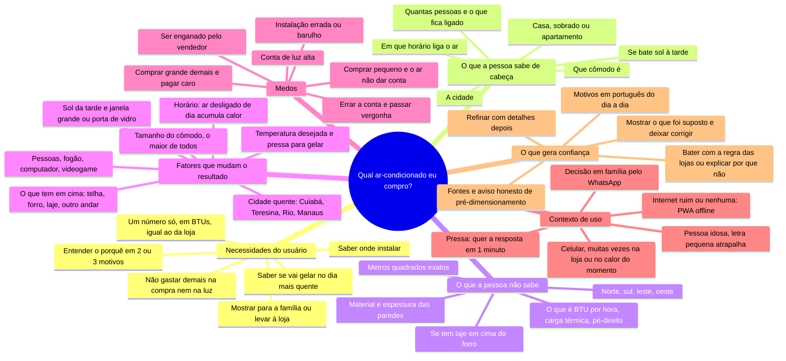
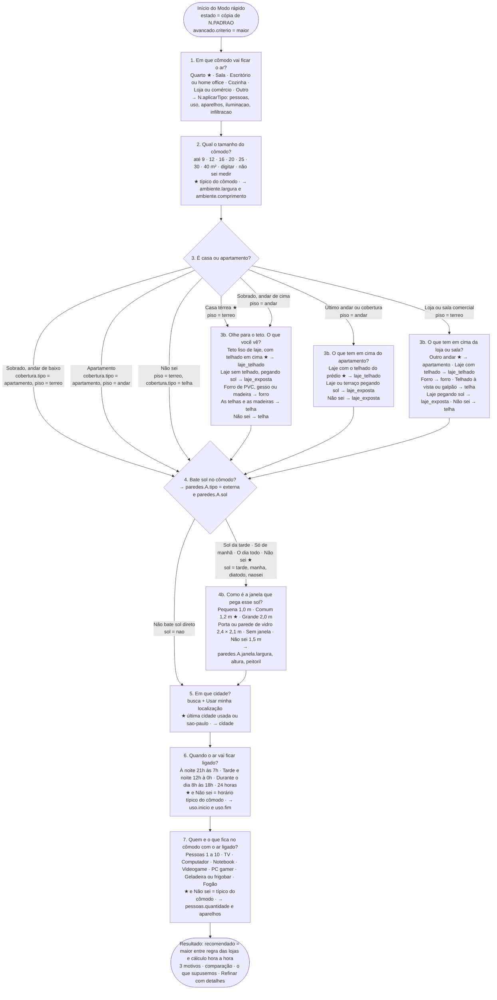
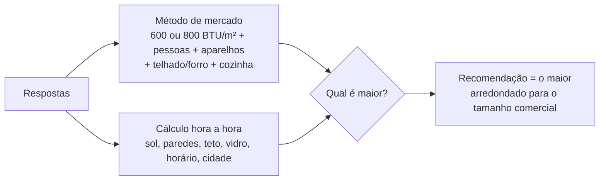

# Mapa mental e árvore de decisões da Calculadora de BTUs

Feito pelo agente `especialista-produto-simples` para desenhar o **modo rápido**: o que a pessoa precisa, o que ela sabe de cabeça e quais perguntas valem a pena.

## Mapa mental

## Árvore de decisões do modo rápido

Cada resposta pula as perguntas que não fazem sentido: apartamento não pergunta o teto; "não bate sol" não pergunta a janela. Por isso são **7 a 9 perguntas**. "Não sei" usa a opção mais segura para a construção (que esquenta mais) e a típica para o uso. ★ = resposta já marcada.

## Regra do resultado

Errar para menos é o que deixa o ar sem dar conta nos dias quentes; por isso o app nunca recomenda menos do que a conta que as lojas e os fabricantes ensinam. No modo detalhado, em "Avançado", dá para escolher só o cálculo físico ou só o de mercado.
